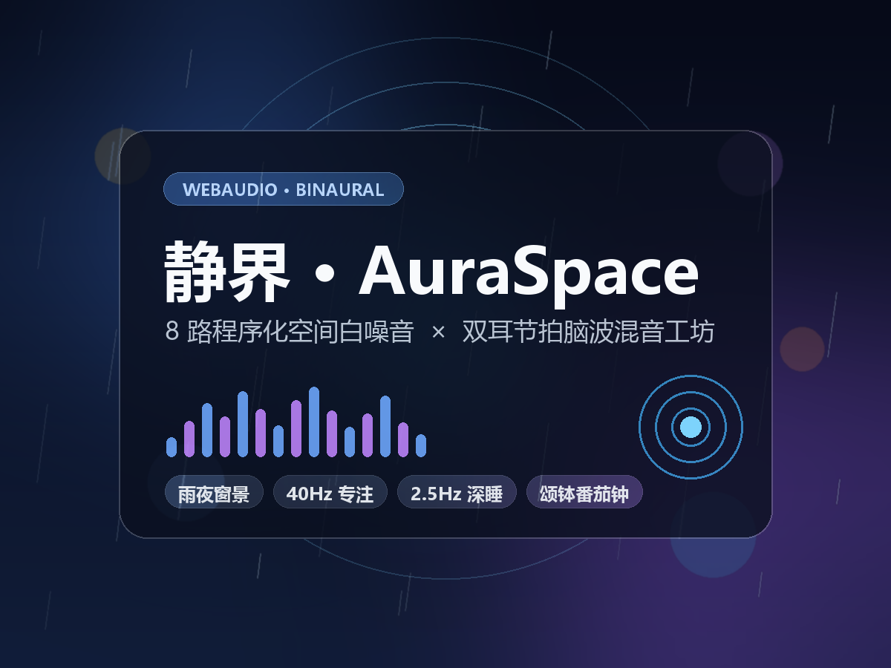
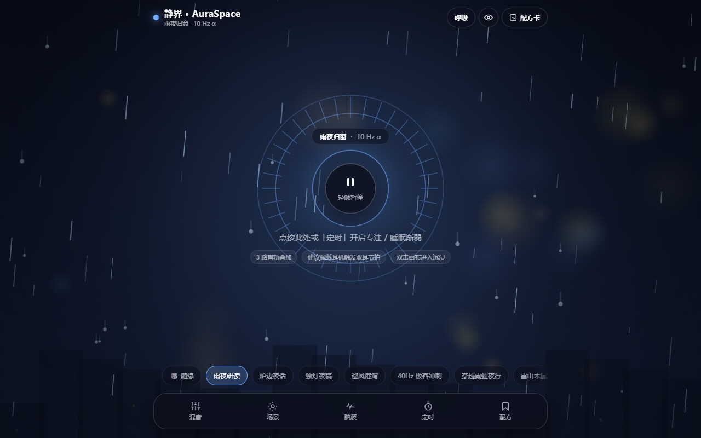
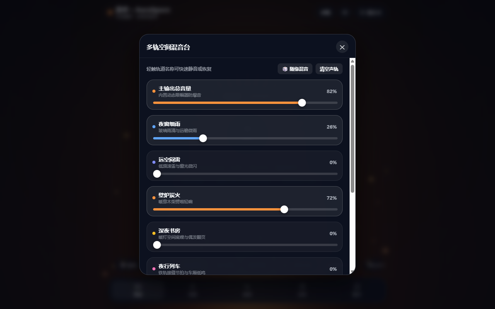
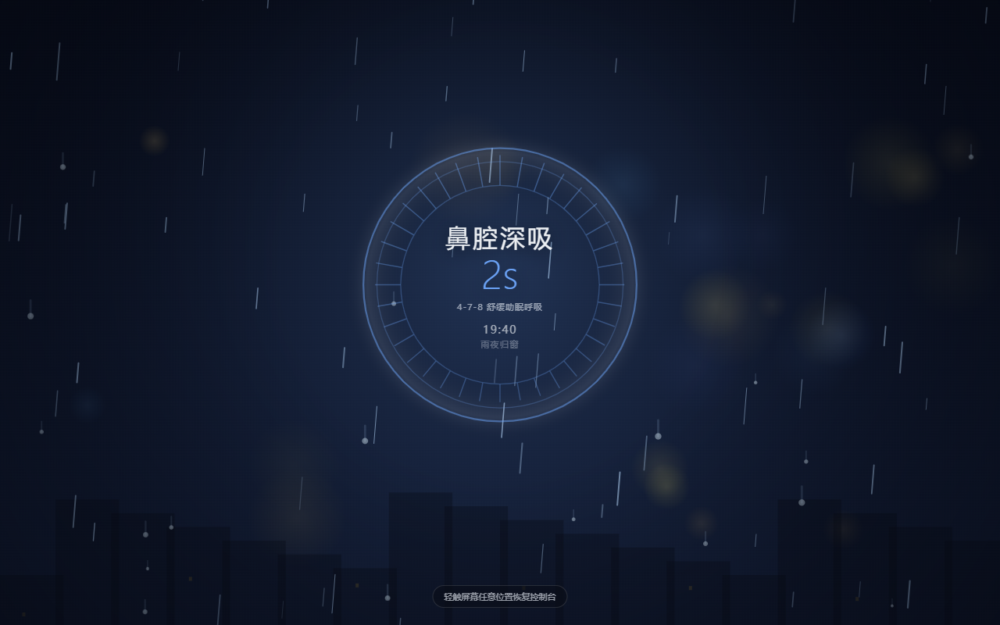
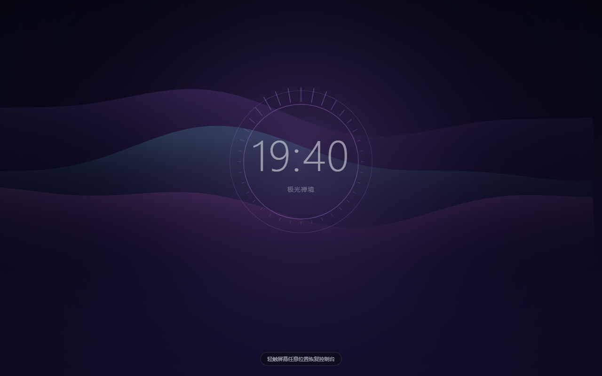
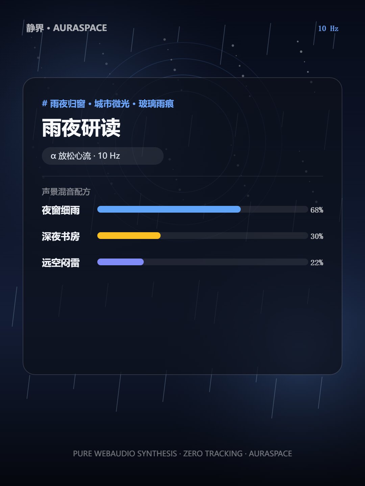

# 静界 · AuraSpace

> 纯浏览器 / 客户端程序化合成的空间白噪音、双耳节拍脑波与沉浸式专注呼吸空间 —— **零外部音频素材、零后端依赖、全端离线可用**。

[](https://github.com/XVSHISAN/AuraSpace/actions/workflows/release.yml)
[](https://xvshisan.github.io/AuraSpace/)
[](./LICENSE)

<p align="center">
  
</p>

## 在线体验与下载

- **在线网页版（PWA，支持手机「添加到主屏幕」）**：[https://xvshisan.github.io/AuraSpace/](https://xvshisan.github.io/AuraSpace/)
- **Windows（`.exe`）/ Android（`.apk`）/ B站 Toy（`.zip`）安装包**：前往 [GitHub Releases](https://github.com/XVSHISAN/AuraSpace/releases) 下载

---

## 核心特性

- **8 路 WebAudio 实时程序化合成声景 + 立体声室内混响**
  - `夜窗细雨`、`远空闷雷`、`壁炉炭火`、`深夜书房`、`夜行列车`、`松林山风`、`深海潮汐`、`星云和弦`，内置动态防爆音压缩限幅器；支持 `🎲 随缘混音` 与单轨轻触静音/恢复。
- **双耳节拍脑波引导 & 1–45 Hz 连续微调**
  - 支持纯净自然声、`10 Hz α`、`40 Hz γ`、`6 Hz θ`、`2.5 Hz δ` 及 `1–45 Hz`（步进 `0.5 Hz`）精准调节，实时匹配生理频段标识。
- **8 套 60fps HiDPI 动态 Canvas 意境场景（声画解耦）**
  - `雨夜归窗`、`冬夜壁炉`、`凌晨书桌`、`近地轨道`、`午夜新干线`、`雪夜松林`、`深海穹顶`、`极光禅境`；支持切背景不覆盖声音，粒子密度响应对应声轨音量。
- **可视化光环呼吸引导（普通 + 沉浸模式）**
  - 内置 **4·4·4·4 盒式专注呼吸** 与 **4·7·8 舒缓助眠呼吸**，沉浸态下于光环正中央实时显示吸气/屏息/呼气阶段与秒级倒计时。
- **专注番茄钟 & 睡眠渐弱独立定时**
  - 支持快捷时长与 **1–180 分钟独立自定义**（滑杆 + `±1m / ±5m` 微调、各自记忆）；番茄钟结束播放程序化颂钵提醒音，睡眠定时末尾 60 秒基于音频时钟平滑淡出且零尾音回弹。
- **极简沉浸桌钟 & 3:4 氛围配方海报卡**
  - 双击画布 / 点眼睛 / `I` 键 / 静置 25 秒进入沉浸，轻触任意位置或 `Esc` 唤醒；支持一键生成 1080×1440（3:4）无水印海报卡与 `#mix=` 分享链接。

---

## 界面预览

| 主界面 & 360° 实时声波光环 | 多轨空间混音台 | 沉浸光环呼吸引导 |
| :---: | :---: | :---: |
|  |  |  |

| 极光禅境沉浸桌钟 | 1080×1440 氛围配方海报卡 |
| :---: | :---: |
|  |  |

---

## 本地构建与多端打包

### 1. 网页离线版（PWA / GitHub Pages）
```bash
node scripts/build.mjs --standalone
python -m http.server -d dist-web 8080
```
浏览器访问 `http://localhost:8080/`。

### 2. 本地打包 Windows 单文件 `.exe`（需 .NET 8 SDK）
```bash
npm run build:exe
# 输出：release/win-x64/AuraSpace.exe
```

### 3. 本地打包 Android `.apk`（需 Java 17 + Android SDK）
```bash
npm install
npm run prepare:android
cd android && ./gradlew assembleRelease
```
> 如本机未安装 Android Studio / Gradle，只需将代码或 tag（如 `v1.0.0`）推送到 GitHub，GitHub Actions 会自动在云端完成 Windows `.exe`、Android `.apk` 与 B站 Toy 包的全部编译并挂载到 Release。

### 4. 构建 B站 Toy 发布包
```bash
node scripts/build.mjs
python scripts/toy_doctor.py dist --poster release/poster.png --slug auraspace --json
python scripts/toy_doctor.py release/auraspace-toy.zip --poster release/poster.png --slug auraspace --json
```

---

## 工程质量与自动化门禁

详见 [docs/QA-REVIEW.md](./docs/QA-REVIEW.md)。发版前可执行全套测试：
```bash
node --test tests/smoke.test.mjs   # 11 项静态/核心单测
node tests/e2e.test.mjs            # 12 项无头 Chromium 真实浏览器 E2E（F01–F11 + Gate）
```

## 开源协议

[MIT License](./LICENSE) © 2026 XVSHISAN
