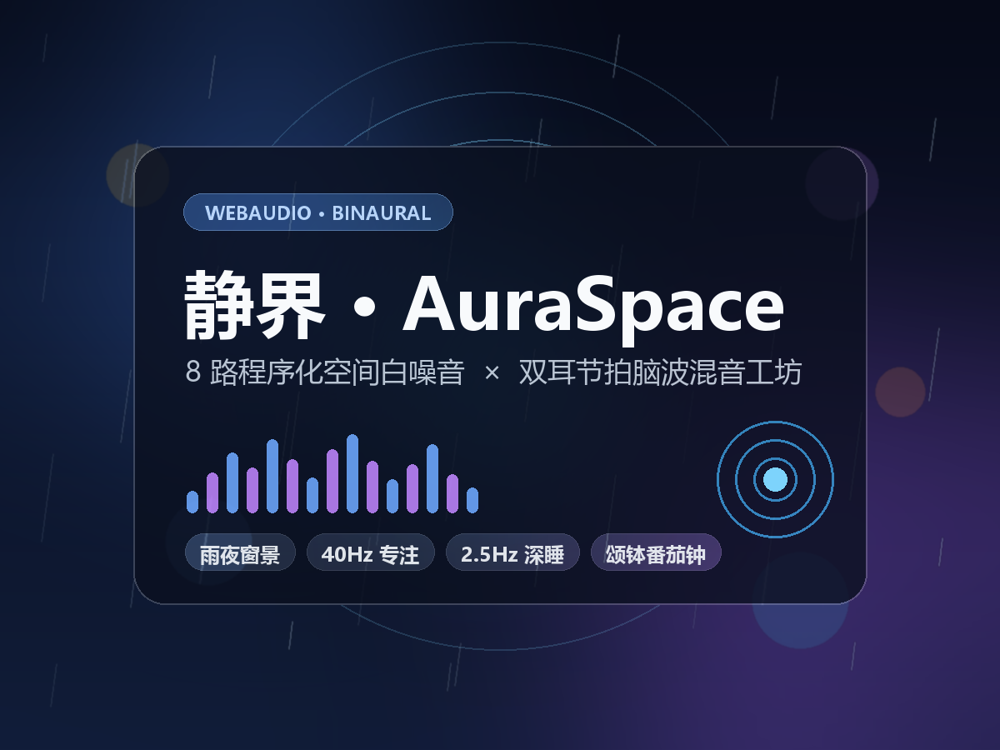
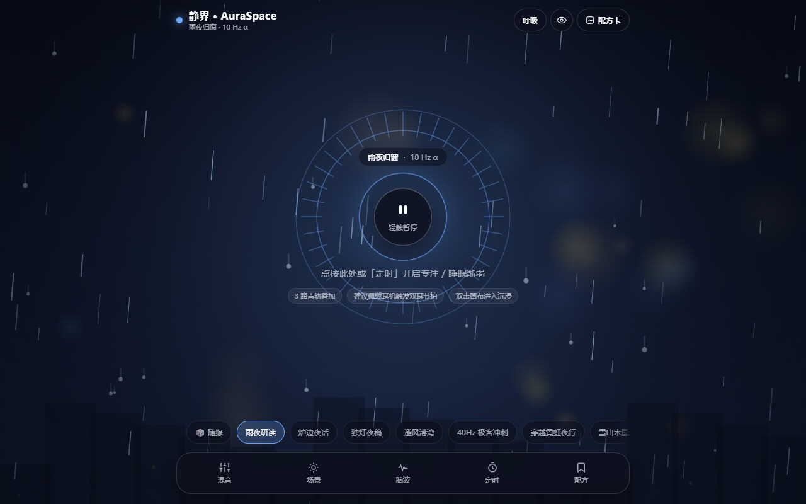
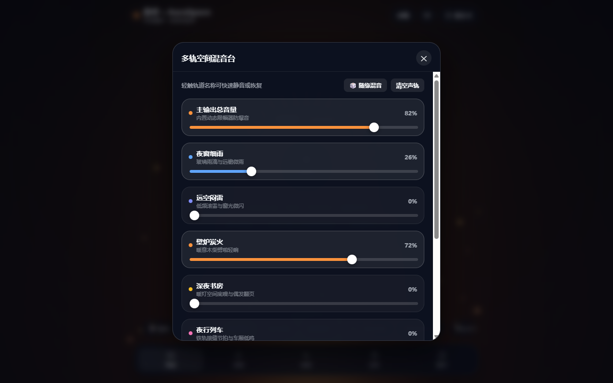
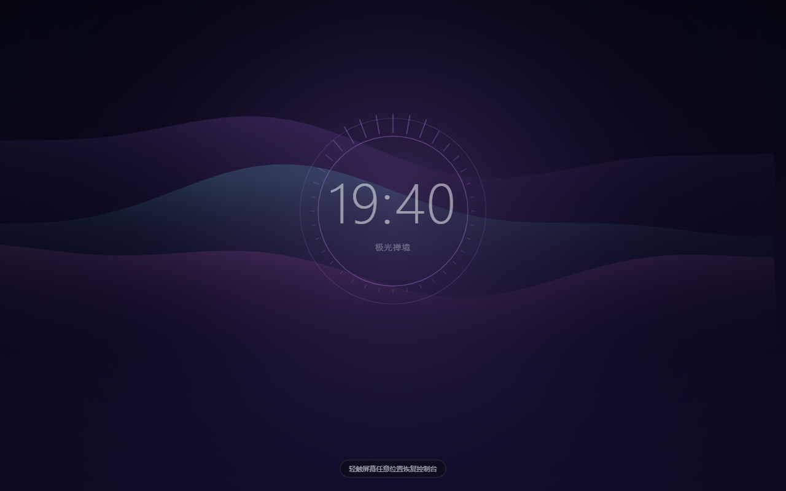
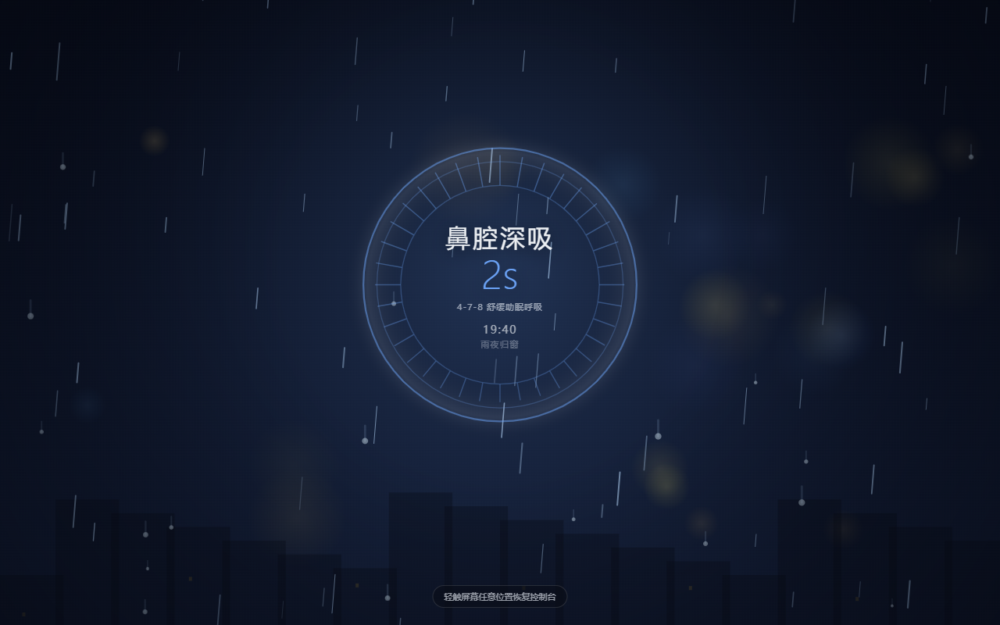
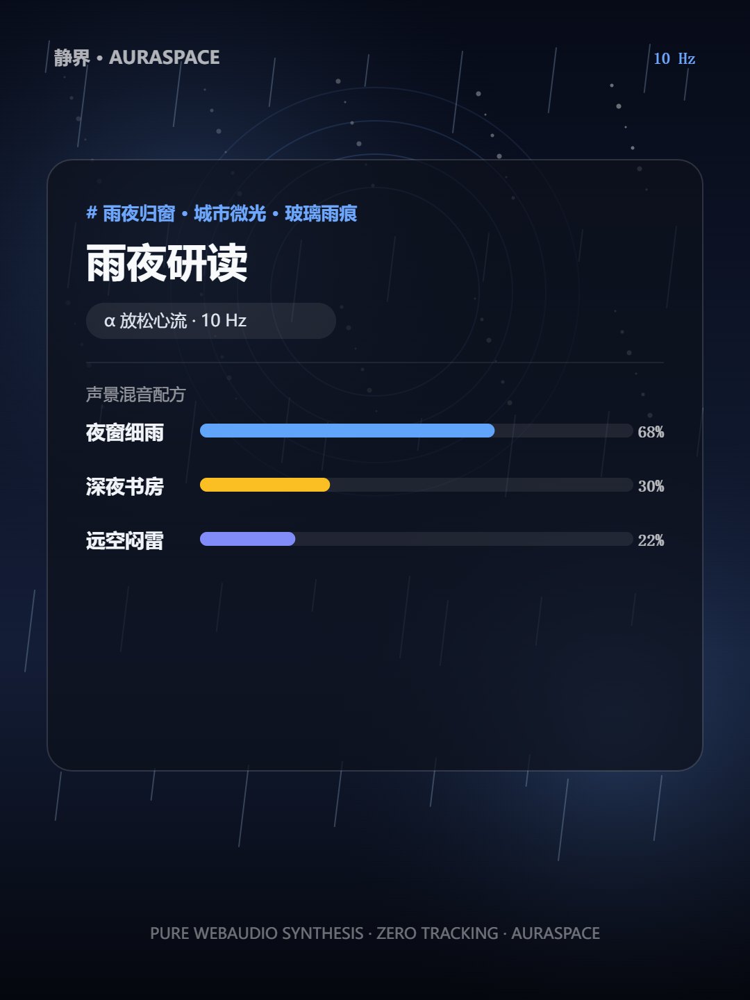

# 入站申请｜静界 · AuraSpace：纯前端实时合成空间白噪音 & 动态意境专注空间

站友们好！我是「我的号码是十六号」，申请加入 B站 Toy 开发者。

## 1、我是谁

我是「我的号码是十六号」，一名独立开发者 / Vibe Coding 爱好者，平时主要关注轻量化效率工具与视听交互体验，也是 B站自习室与助眠白噪音内容的重度用户。

## 2、我的创意

我想上线一款面向 B站学生党、考研/考公自习与夜间助眠人群的沉浸式白噪音与专注空间 Toy —— **「静界 · AuraSpace」**。

很多站友在看 B站云自习室或白噪音视频时，常常希望能按当下心情自由调整「雨声、壁炉柴火、自习室翻书」的比例，再顺手配一个干净的桌面时钟或番茄钟，但又不想专门下载 App 或等待加载几十 MB 的音频包。因此我做了一款即点即用、零音频外链的互动轻应用。

### 目前已完成的核心内容

- **纯 WebAudio 实时程序化合成（0 外部音频文件）**：内置 8 路空间环境声——雨夜细雨、远方雷鸣、壁炉柴火、深夜自习室、夜行电车、山林清风、深海浪潮、Lo-Fi 氛围乐，支持自由多轨混音与立体声空间混响。
- **真实双耳节拍脑波调节**：支持 α（10Hz 放松专注）、γ（40Hz 深度冲刺）、θ（6Hz 灵感冥想）、δ（2.5Hz 舒缓助眠）以及 1–45Hz 精细滑杆微调。
- **8 套全屏动态 Canvas 意境场景**：雨夜窗台、冬夜壁炉、深夜自习、近地轨道、霓虹电车、雪山木屋、深海潜行、极光禅境，搭配 360° 实时声波光环；另内置 10 套精选氛围预设，并支持「随缘」一键生成和谐混音。
- **可视化光环呼吸引导（跟着光环呼吸）**：内置 **4-4-4-4 盒式专注呼吸** 与 **4-7-8 舒缓助眠呼吸** 两种节律，画布中央会生成随节拍平滑扩张与收缩的呼吸光环，实时同步「吸气 / 屏息 / 呼气」阶段提示与秒级倒计时；进入全屏沉浸模式后也会在光环中央保留清晰指引，睡前放松或备考减压时跟着光环呼吸即可快速平复心率。
- **专注与助眠完整闭环**：内置番茄钟（计时结束带程序化颂钵余音）、睡眠渐弱定时（音频时钟平滑淡出），以及极简沉浸桌钟（双击画布进入，轻触任意位置唤醒）。
- **配方海报卡与轻分享**：支持一键生成 1080×1440（3:4）专属「氛围配方卡」海报图和直达当前混音方案的分享链接；全站采用精选意境标签，无自由文本输入，纯前端零后端依赖。

## 3、是否已经有 Demo 或产物

**是！已完成完整可运行的纯静态成品包，获批后可立即上传提审。**

- **极致轻量秒开**：纯原生 HTML / CSS / ES Module JS 实现，无第三方运行时依赖、无后端接口，最终发布包仅 **约 51KB**（入口 `index.html` 约 7.2KB），移动端弱网也能瞬间打开。
- **平台规范与双端适配**：已按文档接入官方 `toy-sdk.js`（安全区适配、云存储限流退避、二维码生成、相册保存与分享），兼顾移动端触控与桌面端体验。
- **官方预检通过**：成品目录与 ZIP 发布包均已通过官方 `toy_doctor.py` 静态检查（**0 报错、0 警告**）。

## 界面与成品预览

### 1. 封面展示

### 2. 主界面与实时声波光环（雨夜归窗）

### 3. 多轨空间混音台（冬夜壁炉）

### 4. 极简沉浸桌钟（极光禅境）

### 5. 沉浸式光环呼吸引导（4-7-8 / 4-4-4-4 跟着光环呼吸）

### 6. 一键导出 3:4 氛围配方海报卡

---

很期待加入 Toy 开发者小站，和站友们一起交流打磨更好用的轻应用，也欢迎大家在评论区聊聊：你平时学习或助眠最喜欢哪几种白噪音叠加？还希望加上什么新场景或环境音？
